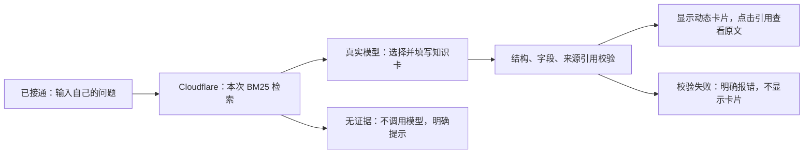

# Live knowledge cards and review delivery

**[Ask on GitHub Pages](https://yuki-uix.github.io/rag-generative-ui-explorer/#ask)**
or [open the full Cloudflare app](https://rgux-web.yuki-uix.workers.dev/ask)
about RAG or Generative UI. The page posts the submitted question to the live
Cloudflare API, retrieves actual passages and asks the native planner to create
cards. Card citations open the exact passages from that request, together with
links to the exact corpus notes. Fixed cards and saved image rankings remain separate
entries. The footer identifies the deployed client commit; publishing this
branch does not merge PR #92 or establish user-outcome effectiveness.

## What happens for a question



The model writes data, never React or HTML. The browser independently reruns
the rendering gate over serialized cards and rejects unknown evidence IDs.
Passing the gates proves structure/reference integrity, not factual correctness:
read the passage to check whether it actually supports the explanation.

## Delivery targets

- The Vinext/Cloudflare application serves `/ask`, `/api/cards`, `/api/health`,
  the project homepage, `/cards` and `/experiments/images`.
- GitHub Pages serves the same questioning component at `#ask`, configured
  through repository variable `LIVE_CARDS_ENDPOINT` during the Pages build.
  Only a public API URL enters the client. The model key stays in the Worker
  secret binding. If the variable is absent, `#ask` explicitly shows connection
  status and sends no question. It never uses a mock fallback.
- `.github/workflows/image-review-pages.yml` publishes the branch preview from
  `codex/image-retrieval` or `main`. Cloudflare is deployed with `pnpm web:deploy`,
  which builds the current full application before uploading it.
- The old public `/api/ask` endpoint returns 410. It previously bypassed the
  live-card protections. The unchanged Markdown baseline CLI/evaluation remains
  available; neither the old route nor the fixed gallery is the new live path.

## Live configuration, separate from F5

The deployed retriever is lexical BM25 over the committed retrieval bundle,
with up to eight scored passages. It is not the dense or fused evaluation arm.
A deterministic web-only Chinese technical-term bridge adds English keywords
for terms such as sparse/dense retrieval and reranking; the original submitted
question is preserved in the model prompt. The UI records the actual retrieval
query and `technical-terms-v1` or `none`. General Chinese semantic retrieval is
not established by this small mapping.

The web runtime reuses the native planner, original system/user prompt and DeepSeek
profile. `live-cards-5` records these web-only generation differences:

1. `thinking: {type: "disabled"}` is sent through the request adapter to bound
   interactive waiting, without changing the shared model profile.
2. A cloned planner schema restricts `EvidenceId` to this request's offered
   `E1`…`En` handles. The prompt already requires these short handles, while the
   shared contract schema describes final corpus IDs. Handles resolve to actual
   IDs before the unchanged contract and citation gates execute. No invalid
   output is repaired into acceptance. The cloned schema also requires a nonempty
   card set for complete answers and a reason for incomplete answers.
3. A short web-only system suffix requires bare JSON. Generated card text is
   restricted to `summarized` or `inferred` mode in both the request schema and
   the web policy. Model-authored `extractive` text is rejected, not relabeled.
   Verbatim source text is rendered directly from the corpus in the source
   drawer and evidence cards. The original planner prompt remains the prefix,
   and the submitted question/evidence is preserved.
4. The `live-cards-5` suffix preserves source scope, qualifiers and modality in
   titles and fields. A rationale or recommendation must not become an empirical
   adoption claim, a universal guarantee or a measurement. Each field must cite
   the specific passages supporting its exact claim. This mitigates an observed
   semantic failure; it is not an automatic entailment check.

Generation makes one request, disables SDK retries and caps output at 4096
tokens with a 60-second deadline. Any invalid card rejects the full response.
These choices are an interactive product policy, not an F5 comparison result.
No shared generation package, knowledge note, evaluation protocol or F5 artifact
is edited. No LLaVA is integrated.

## Public API bounds

`/api/cards` accepts strict JSON with one nonempty question, at most 1000
characters and 8192 body bytes, with a five-second body-read deadline and
cancellation handling. Generation has a separate deadline. Errors are sanitized;
provider response bodies and credentials never reach the browser. The source
passages are public project corpus content.

The Worker allows its own origin and the exact GitHub Pages origin, plus listed
local development ports. This CORS policy is a browser boundary, not user
identity or protection from direct HTTP clients. A per-isolate limiter allows
four simultaneous operations and eight requests per client per minute, with
bounded expiring bookkeeping. This is coarse abuse protection, **not an
account-wide billing quota**. The interactive site is a public pilot; do not
represent these limits as durable authentication or a global spend cap.

Cancel stops the browser waiting; a provider may already have begun work and
incurred usage. The UI says so. Zero-evidence questions skip the model entirely.

## Review steps

1. Ask “为什么重排不能提高召回率？” or an English RAG question. Inspect the
   newly generated card, real retrieval query, model, elapsed time and tokens.
2. Click a field's citation. Check the exact passage, corpus-note link and whether
   it supports that field. These are this question's sources.
3. Ask a question outside the corpus. A zero-hit question shows evidence
   insufficiency with no model call; lexical overlap may still retrieve passages
   for other unrelated questions, so this is not a calibrated relevance filter.
4. Open `#cards` for the five fixed component examples.
5. Open `#images`, compare all three saved ranking arms and switch full-corpus
   versus known-topic selection for `doc-02-diamond`. Inspect original gold
   warnings, correction notes and failures beside the historical images.

## Reproduction and checks

```sh
pnpm web:planner-schema:check # generated planner schema matches shared source
pnpm web:images:check         # sealed experiment projection; no model call
pnpm web:review:dev           # static client at http://127.0.0.1:4174/
pnpm web:review:build         # static output in apps/web/dist-review/
pnpm web:dev                  # full app including the Worker API
pnpm web:deploy:check         # full build and dry-run; no publication
pnpm web:secret:list          # binding names only, never their values
pnpm web:deploy               # fresh build and Cloudflare publication
```

For repository-path hosting, set `REVIEW_BASE_PATH=/rag-generative-ui-explorer/`
and `VITE_LIVE_CARDS_ENDPOINT` to the deployed `/api/cards` URL. The Pages workflow
also sets `VITE_REVIEW_BUILD_SHA`. For local full-app calls, configure the secret
in the ignored `apps/web/.dev.vars` file; never use a `VITE_` variable for a secret.

The image projection verifies both input freezes and observation seals before
building the public data and 48 PNGs. It does not edit `eval/`, run OCR/CLIP,
read credentials or call a model. Both static and full-app bundles are scanned
for server-only code. Offline API tests mock only the provider transport while
exercising actual retrieval, request construction, validation and error paths.
UI tests exercise real gates, failure states, cancellation and source display.

Live smoke observations, including rejected attempts and timing limits, are
recorded in [the live check report](LIVE-CARDS-CHECK.md). They are integration
checks, not a controlled effectiveness evaluation.

The [follow-up live review](LIVE-CARDS-REVIEW.md) records cross-question guards,
full HTTP-failure records, client waiting limits and no-answer behavior.

Generation revisions are provenance metadata rather than card-format versions.
The client validates their `live-cards-N` format and displays the actual returned
revision while retaining the same question, schema and citation gates. This
allows compatible client/API revisions during a rolling deployment.
