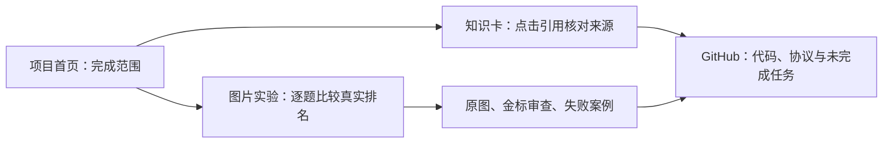

# Reviewable web delivery

The [project preview](https://yuki-uix.github.io/rag-generative-ui-explorer/)
provides an entry point for reviewing the work before merging PR #92. Its footer
links to the exact web source commit. It is a static preview of existing
components and saved experimental observations, not a claim that the MVP or
user-outcome evaluation is complete.

## What to review

1. Start at the project overview: what exists, which interactions are available,
   and what still needs integration.
2. Open knowledge cards. Click a field's evidence marker and inspect the real
   corpus excerpt in the source drawer. These are fixed, gated examples, not
   newly generated answers.
3. Open the image experiment. Change question/type, compare the three Top 1
   images, expand the complete ranks, and open a gold image at original size.
4. For `doc-02-diamond`, switch from full-corpus retrieval to known-topic
   selection. CLIP's winner changes from the wrong topic to a correct style.
5. Inspect the historical fusion concept question's incomplete gold warning and
   query-transformation diagram's visible content erratum. Historical labels
   are preserved, not silently corrected after seeing results.



## Same components, two delivery targets

- The existing Vinext/Cloudflare application has `/`, `/cards`, `/ask` and
  `/experiments/images`. `/ask` uses real server-side retrieval/model calls.
- GitHub Pages has a static overview and hash routes `#cards`, `#images`, `#ask`.
  It reuses the same homepage, gallery and experimental browser. `#ask` explains
  that no live API is hosted there; it never submits a paid or fake model call.
- The static preview is published by `.github/workflows/image-review-pages.yml`
  from `codex/image-retrieval` or `main`, with an exact source-commit link. It
  does not merge either branch. Cloudflare remains the runtime deployment path.

The current local Cloudflare session could not authenticate during delivery on
2026-10-22. No previously deployed Worker URL or live model availability is
claimed from a historical deployment record. Restore the ordinary Wrangler
login before updating that separate online service.

## Reproduction and checks

```sh
pnpm web:images:build   # project sealed observations into JSON and 48 PNG assets
pnpm web:images:check   # fail on drift; does not run OCR or download a model
pnpm web:review:dev     # local static preview at http://127.0.0.1:4174/
pnpm web:review:build   # static output in apps/web/dist-review/
pnpm web:dev           # full app, including API (credentials needed for /ask)
pnpm web:deploy:check  # full Cloudflare build and dry-run, no publication
```

For repository-path hosting, build with
`REVIEW_BASE_PATH=/rag-generative-ui-explorer/ pnpm web:review:build`.
The workflow also sets `VITE_REVIEW_BUILD_SHA` to the actual commit.

The data build verifies both experiments' input freezes and observation seals
before generating the browser projection. It preserves first-pass scores and
complete candidate orders, checks public PNG hashes, and keeps the fixed
experiment source commit distinct from the later web source commit. It never
edits `eval/`, executes a model, or reads credentials. Static publishing uploads
only `dist-review`, not environment files, cached weights or execution binaries.

Tests cover projection integrity, all question/arm combinations, the known
failure cases, filtering, corpus switching, scope switching and source/OCR
inspection. Existing rendering gates remain active. The F5 baseline and its
worktree remain unchanged. No LLaVA is integrated.
