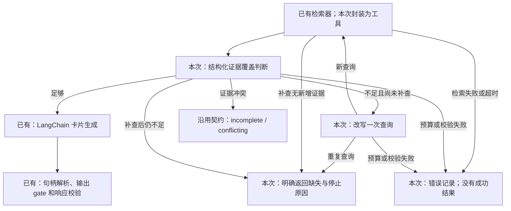

# F3: one bounded supplemental retrieval

Implements [#81](https://github.com/yuki-uix/rag-generative-ui-explorer/issues/81)
in the experiment CLI. LangGraph manages conditional transitions; LangChain
invokes the existing retriever as a schema-checked tool and the model through
the F2 adapter. The final generator still uses F2's prompt, handle resolution,
`@rgux/contracts.gate`, and `KnowledgeUIResponse`. No application migration or
effectiveness claim follows from this integration exercise.

## Reproduce

```bash
pnpm install --frozen-lockfile
pnpm framework:graph                         # no credentials or network
pnpm framework:smoke --implementation langgraph  # same default graph config
pnpm framework:graph --live                  # explicit real provider calls
```

Live mode reads `DEEPSEEK_API_KEY` from the environment. It uses the actual BM25
retriever without fixture omissions, real coverage/rewrite decisions, and the
real card planner. It refuses `--scenario` and missing credentials before
creating a run. The three samples have a shared maximum of **12 HTTP attempts**,
at most four per question, including coverage, rewrite, and generation. Both
framework and SDK retries are zero; format repair is disabled as in F1/F2.
Control calls allow 2048 output tokens, generation 4096, and each call/tool has
a 60-second deadline. Retrievers currently lack a cancellation parameter: a
tool timeout stops graph progression, but does not cancel the underlying search.

The [config](graph.json) pins `@langchain/langgraph 1.5.1` via the lockfile,
one supplemental retrieval, `k=4`, at most 12 retained evidence items, and a
12,000-character **user-message** cap. The cap includes original question and
evidence; control messages additionally check the serialized query history
and missing items. Fixed system prompts/schema are separately versioned, not
included in that character count; this is not a tokenizer-based cost limit.
Candidates are appended in retrieval order, deduplicated by corpus ID, and
excluded when a cap would be exceeded. A context limit is a recorded error,
not a claim that the corpus has no answer.

## Implemented path and boundaries



[`graph.ts`](../../packages/generation/src/experiment/graph.ts) uses
`StateSchema`, `StateGraph`, and conditional edges. The single state value
preserves original question, pending query and history, retained evidence,
missing items, structured coverage, counters, snapshots, events, and stop
reason. The graph uses last-value state updates, not a reducer that appends
the same evidence every time a node is replayed. This is an in-process CLI
state, not a durable checkpoint or the planned M5 business `RunStore`.

The retriever tool validates query and `k`, delegates to the existing
`Retriever.search`, validates returned candidates against the pinned corpus,
and never asks the model to supply corpus IDs. Coverage must return `sufficient`,
`missing`, or `conflicting`, named missing items when applicable, a reason,
and offered `E1`, `E2`, ... handles. Unknown or duplicate references are rejected;
conflict requires two distinct references. Code owns limits and legal edges.
The model's coverage decision is a suggestion, not a semantic proof of support.

[`transport.ts`](../../packages/generation/src/experiment/transport.ts) shares
the F2 HTTP accounting boundary across all model stages, so an attempted retry
cannot evade the overall cap. Query equality normalizes Unicode, whitespace,
and case. At most two tool calls and four model calls can occur per question;
the LangGraph recursion limit is an additional defensive stop.

## Observed offline execution: 2026-10-20

The committed [manifest](results/f3-2026-10-20/run.json),
[inputs](results/f3-2026-10-20/inputs.json),
[complete records](results/f3-2026-10-20/records.jsonl), and
[summary](results/f3-2026-10-20/summary.json) preserve one representative run.
The manifest records the base commit plus dirty source fingerprint, dependency
versions, model/profile, schema/prompt hashes, and graph policy. These are
original artifacts; later edits do not rewrite their historical fingerprint.

| Sample | Controlled path | Model transport attempts | Tool calls | Outcome / stop |
| --- | --- | ---: | ---: | --- |
| `rag-001` | retrieve → check → generate → gate | 2 | 1 | valid / `generation-valid` |
| `rag-003` | retrieve → check missing → rewrite → retrieve → check sufficient → generate → gate | 4 | 2 | valid / `generation-valid` |
| `ins-001` | retrieve → check missing → rewrite → retrieve → check missing → stop | 3 | 2 | incomplete missing / `supplement-limit` |

There were **zero external model requests**. The real corpus, BM25 retriever,
LangChain tool, LangGraph engine, Anthropic stream parser, and output gate ran.
[`graph-fixtures.ts`](../../packages/generation/src/experiment/graph-fixtures.ts)
deliberately withholds some first-pass BM25 candidates and supplies synthetic
coverage, rewrite, and generation responses to select the three paths. The
insufficient label chooses a smoke scenario only; live control flow never uses
the evaluation label. Fixture usage numbers and local timings are synthetic
plumbing observations, not cost, latency, or answer-quality measurements.

Inspect `snapshots[0]` and `[1]` for the exact evidence before and after the
supplement, including `addedIds`, `droppedIds`, and retained text/scores. Each
`calls[]` entry records offered IDs, original raw completion, actual serialized
request, stop reason, usage, and error. `generation.evidence` is exactly the
final snapshot, and the shared handle-resolution/validation path uses only that set.
`events[]` explains the coverage branch; `stopReason` explains termination.
`timingMs` records graph-node durations; generation retains F2's separate
generation/validation timings. No headers, URL credentials/query, or provider
error messages are saved. Runs append completed questions immediately; there
is no mid-question crash recovery in F3.

## Failure and debugging record

```bash
pnpm framework:graph --scenario invalid-reference  # exits 1 after saving
pnpm framework:graph --scenario tool-error         # retrieval failure, not missing
pnpm framework:graph --scenario supplement-tool-error
pnpm framework:graph --scenario repeated-query    # incomplete; no second search
pnpm framework:graph --scenario no-new-evidence   # incomplete; no second check
pnpm framework:graph --scenario conflicting       # incomplete / conflicting
```

The committed [failure trace](results/f3-invalid-reference-2026-10-20/records.jsonl)
and [summary](results/f3-invalid-reference-2026-10-20/summary.json) show `E999`
in the raw final generation. Coverage succeeds, but the **existing** validation pipeline rejects
the generated card with an `evidence-reference` failure. Every sample has
`result: null` and `stopReason: generation-invalid`; the CLI exits 1. No reference
is guessed, deleted, or repaired. This demonstrates that a successful graph
branch is not sufficient to publish a card.

During completion of the local draft, the generation node constructed a fixture
transport without actually passing it to F2's runner. Such a wrapper would let
a graph-specific invalid-reference fixture silently turn into F2's ordinary
valid fixture. The node now passes the transport through the common runner's
recording/budget boundary. Tests assert both a graph-specific `E999` rejection
and rejection of `E5` when only four evidence items were offered.

The [tests](../../packages/generation/test/graph.test.ts) also cover repeated
queries, no new evidence, a second missing decision without a third search,
tool parameter failures, unknown corpus IDs, an actual hanging-tool timeout,
per-question and shared budgets, context/evidence caps, malformed control
output, provider failures without retries, refusals, truncation, and duplicate
conflict references. CLI tests inspect saved payloads and exit codes rather
than assuming exit 0 alone proves success. CI runs the three-path smoke command.

## Tradeoff and next experiment

LangGraph makes the coverage/rewrite loop and stopping branches visible and
records state in one place. LangChain supplies a schema-checked tool boundary
and the same structured-output adapter as F2. Custom code is still required
for corpus trust, reference validation, budgets, query deduplication, context
selection, safe diagnostics, and failure semantics. The sufficient path needs
one more model call than F2; the supplemented path needs three more. That is
additional work/cost capacity, not demonstrated benefit.

Keep this as an experiment and retain the native application default. F3 has
not made a live call or measured coverage accuracy, semantic support, retrieval
improvement, monetary cost, or comparative latency. [F5 / #83](https://github.com/yuki-uix/rag-generative-ui-explorer/issues/83)
must freeze a separate strategy protocol with final-context budgets and
repetitions under [PROTOCOL.md](../PROTOCOL.md) before comparing LangChain
single retrieval against adaptive LangGraph retrieval. This differs from F2's
identical-evidence comparison. [F4 / #82](https://github.com/yuki-uix/rag-generative-ui-explorer/issues/82)
remains optional persistence work.
