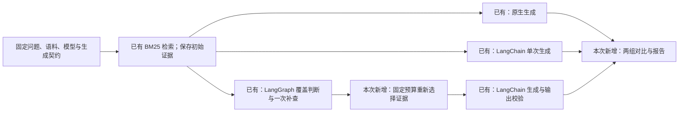

# F5: framework comparison pilot

First deliverable for [#83](https://github.com/yuki-uix/rag-generative-ui-explorer/issues/83),
2026-10-21. The original offline integration report is retained below.
The subsequent [repeated live pilot](F5-LIVE-PILOT.md) adds 44 real requests,
field-level AI semantic judgments and observed billing. **F5 remains open**
for the full 60-question effectiveness evaluation.

## Reproduce and inspect

```bash
pnpm install --frozen-lockfile
pnpm framework:study                          # 3 questions, 1 repetition, offline
pnpm framework:study --scenario invalid-reference  # exits 1 after saving failures
pnpm framework:study --live                   # explicit pilot, at most 18 HTTP attempts
```

Live mode reads `DEEPSEEK_API_KEY` from the environment. It refuses fixture
arguments and missing credentials before creating a run. Default smoke makes
zero external model requests even if a key is present. The corpus, BM25,
native SDK, LangChain, LangGraph and common validation pipeline are real; only
model replies are synthetic. Unlike the F3 routing demo, study smoke does not
withhold first-pass BM25 candidates. Labels select smoke responses only and
never enter live prompts or context selection.

Each invocation writes a unique ignored directory under `eval/framework/runs/`:

| File | Contents |
| --- | --- |
| `run.json` | Frozen config and hash, corpus/index/question/schema/code/dependency pins, model profile, control prompt versions, mode, fixture version, order policy and request budget |
| `inputs.json` | Selected questions and labels |
| `fixed-inputs.json` | Shared native/LangChain evidence, saved **before** the first model call |
| `records.jsonl` | Appended after each question/arm/repetition; original raw completions, actual requests, validation outcomes, graph snapshots and stop reasons |
| `summary.json` | Metrics, per-repetition dispersion and cell sample sizes, paired wire differences, strategy pairs, four token totals, explicit unknowns |
| `report.md` | Readable report generated from the same summary |

No summary means the run did not complete. A complete report with failed
payloads exits 1 after saving all records; exit 0 is not used as a substitute
for inspecting results. Header credentials and provider error messages are
excluded through the existing shared transport. Mid-question recovery remains
the optional F4 work.

## Frozen strategy protocol v1

This supplements [PROTOCOL.md](../PROTOCOL.md) for the intentional retrieval
strategy change; it does not relax M4's display-arm comparison rules.



The [pilot config](study-pilot.json) freezes three previously used questions
and one repetition. The [evaluation config](study-evaluation.json) freezes the
full 60-question file, three repetitions per question per arm, and a worst-case
**1080-attempt** budget. It is execution capacity, not an assertion that the full
study has been completed. Both configs freeze the question-file SHA-256, corpus
version, generated planner-schema hash and prompt version. Any drift fails
preflight and requires an explicitly revised baseline. Labels are unchanged;
the evaluation set is previously exposed, not a new blind test. Development
failure fixtures remain separate from live effectiveness results.

```bash
# A deliberate full run, using the key supplied through the environment:
pnpm framework:study --live --config eval/framework/study-evaluation.json
```

The runner reserves every arm's worst-case requests before starting. Each
native/LangChain sample allows one generation; the graph allows at most four
calls including coverage and rewrite. SDK/framework retries are zero and repair
is disabled. The same endpoint/profile, 4096-token final generation cap, corpus,
schema, planner prompt and validator are used throughout. Graph control calls
retain F3's separate 2048-token cap and 60-second timeout. The actual generation
request is checked for endpoint, model, prompt, output cap, streaming, thinking,
effort and absent sampling overrides; differing fixed-input pairs are rejected.
Arm order rotates by question and repetition, with the exact order recorded.
This reduces fixed-order bias but is not randomization or provider-cache control.

Both strategies start with the same BM25 query and `k=4`; their initial retained
evidence must match. The **final context is capped at 4 evidence items and
12,000 user-message characters in every arm**. Fixed system/schema overhead is
separately pinned and is not included in that character cap. F3 policy v1's
append-only context would fill all four slots before a supplement. The new
`bounded-retrieval-2` policy reserves the first two original passages, prioritizes
novel supplemental passages, and fills any remaining slots in retrieval order.
IDs are deduplicated; selection uses no golden labels and does not compare BM25
scores across different queries. Every omitted or displaced ID is recorded.
The original F3 v1 config and historical artifacts keep their original policy.

Final-context Recall@4 is scored against the unchanged golden IDs, including
retained contexts on a graph stop that did not generate cards. Cumulative found
IDs and cumulative recall are recorded separately, including retrieved passages
excluded from the final context. They are never substituted for Recall@4.
Answerless questions have no recall denominator and report `null`. Once query
rewriting is live, retrieval metrics are model-dependent and require repetitions.

Usable-result rate includes validated complete and incomplete results. Missing
evidence accuracy compares the `missing` decision to `expectInsufficient`;
failed results count as incorrect. First-attempt card validity includes only
completed `end_turn` final generations, with its denominator recorded; provider
errors, refusal and truncation remain separate outcomes. Coverage-only incomplete
responses cannot inflate card-generation validity. Semantic citation precision
and unsupported-claim rate remain `null` until a documented human/judge review.

`executionMs` measures each arm invocation, including fresh retrieval and
orchestration. Each baseline reruns BM25 for every question/repetition, verifies
the selected evidence still matches the frozen snapshot, and records that
lookup's actual duration; graph node timings include its own searches. Initial
snapshot freezing is excluded from every arm's time. The report
does not equate this with browser render latency or TTFC. Token usage comes
from all actual control/generation responses and retains uncached input, cache
writes, cache reads and output separately. A missing usage value, including a
failed request with no usage, makes that total unknown; it is never replaced by
zero. The original runtime summary leaves monetary cost `null`. The live extension
pins published rates and adds a separate, offline-reproducible audit without
rewriting that original summary.

## Observed pilot and failures

The committed [pilot report](results/f5-pilot-2026-10-21/report.md),
[manifest](results/f5-pilot-2026-10-21/run.json), and
[complete records](results/f5-pilot-2026-10-21/records.jsonl) contain one run of
three questions × three arms × one repetition. The dirty source fingerprint
records the code at execution time; later documentation/artifact commits do not
rewrite that historical fingerprint.

| Observation | Recorded evidence | Interpretation allowed |
| --- | --- | --- |
| Complete result | `rag-001`: native and LangChain each use one request; graph uses two; all validate | SDK/framework/validation integration works on the fixture |
| Supplemented result | `rag-003`: graph retains 4 of 6 cumulatively found passages; final Recall@4 changes from 0 to 0.5 | The fixed-budget selection and retrieval scoring work; synthetic control chose the rewrite |
| No retrieval gain | `rag-001`: final Recall@4 stays 1/3, graph adds one call | Extra calls do not necessarily add retrieved coverage, even in the demo |
| Explicit missing result | `ins-001`: graph stops at `supplement-limit`, with `incompleteReason: missing` | Bounded termination works; fixture labels are not evidence of detection accuracy |
| Invalid citation | Separate [failure report](results/f5-failure-2026-10-21/report.md) and [trace](results/f5-failure-2026-10-21/records.jsonl): all nine final generations cite `E999`, are rejected and publish no result | A graph success branch cannot bypass the common citation boundary |

The pilot uses **15 synthetic transport attempts**: 3 native, 3 LangChain and
9 graph, with zero external requests. The separate failure run uses 12 synthetic
attempts and exits 1. No F2 live observations are pooled into these figures.
Per-repetition values and median/full range are available in the JSON report;
one repetition supplies no evidence of model variance. Cells are grouped by
domain and acceptable card-type membership, may overlap, and carry their n.
No answer-quality, latency-saving or monetary-saving claim follows from this run.

## Engineering finding and adoption decision

The new harness exposed a comparison problem in the F3 config: allowing the
graph to append up to 12 passages while a baseline receives 4 would give the
graph more chances to hit golden evidence. Simply lowering its append-only cap
to 4 would instead prevent any novel supplement from reaching the generator.
The versioned replacement policy and separate cumulative/final metrics make
that tradeoff inspectable. The [tests](../../packages/generation/test/study.test.ts)
verify eviction, fixed caps, equal initial evidence, reference failures, missing
usage, pin drift, actual request differences, repeats, ordering and CLI artifacts.

Native keeps the smallest single-call implementation. LangChain supplies a
common message/structured-output interface; LangGraph makes the bounded branch
and state visible. Corpus trust, context selection, budgets, safe diagnostics,
business validation and reporting still require repository code. Keep the
frameworks as experiments until repeated live runs and semantic review justify
adoption. The [small repeated live pilot](F5-LIVE-PILOT.md) now provides exploratory AI
support judgments and pinned pricing. The full 60-question run, independent
semantic assessment and final effectiveness decision remain open under #83.
