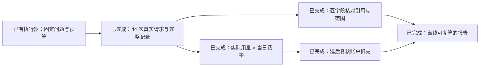

# F5 live pilot: semantic support and observed cost

**2026-10-21. Three exposed questions, three repetitions, three implementations.**
The run made **44 real DeepSeek requests** out of a reserved maximum of 54,
between 04:39 and 04:51 UTC (12:39–12:51 Asia/Shanghai). No retries, repair,
or replacement runs were performed. All 27 sample records were preserved,
including four rejected results. This is a repeated small-sample pilot, not the
60-question F5 effectiveness evaluation; #83 remains open.

## Inspect or reproduce

The [original manifest](results/f5-live-pilot-2026-10-21/run.json) pins the
model/profile, corpus/index/question/schema hashes, source fingerprint, runtime
versions, budgets and order. The model alias is `deepseek-v4-pro`; the
[official pricing page](https://api-docs.deepseek.com/quick_start/pricing/)
identifies its served version as DeepSeek-V4-Pro-0813 on the verification date.
The [config](study-live-pilot.json) retains the same three questions, `k=4`,
four final evidence slots, 12,000-character user context, 4096 generation tokens,
2048 control tokens and zero retries from the pilot protocol.

```bash
# Explicitly creates new paid observations; supply your own environment file:
pnpm --filter @rgux/generation exec node --env-file=/absolute/path/.env.local \
  --import tsx scripts/study.ts --config eval/framework/study-live-pilot.json --live

# Entirely offline: recompute the committed semantic and cost audit:
pnpm framework:audit \
  --run eval/framework/results/f5-live-pilot-2026-10-21 \
  --review eval/framework/results/f5-live-pilot-2026-10-21/semantic-review.json \
  --billing eval/framework/results/f5-live-pilot-2026-10-21/billing-observation.json \
  --out /absolute/path/to/a/fresh/audit-directory
```

The offline command checks study completeness, frozen questions and corpus
content, reparses/re-gates saved results, binds review judgments to exact raw
records/card context, checks quoted source excerpts, and prices every actual
request. It creates `audit.json`, `audit.md` and a review inventory without
credentials or network. Use this frozen corpus/schema checkout; changed pins
are refused. Original `summary.json`/`report.md` describe the run before review
and remain immutable. The derived [audit](results/f5-live-pilot-2026-10-21/audit.json)
and [readable audit](results/f5-live-pilot-2026-10-21/audit.md) contain the
subsequent semantic and billing results.



## Mechanical results and variation

Every arm has **n=9 responses from only three unique questions**. Incomplete
results include the correct database-pricing refusal, not just useful answers.

| Arm | Complete / incomplete / rejected | Usable result rate over all 9 | Per-repetition usable-rate median [range] | Requests | Execution seconds, median [full range], n=9 |
| --- | --- | --- | --- | ---: | --- |
| native | 5 / 3 / 1 | 8/9 | 1.00 [0.67, 1.00] | 9 | 23.91 [1.68, 41.23] |
| LangChain | 5 / 3 / 1 | 8/9 | 1.00 [0.67, 1.00] | 9 | 19.64 [2.09, 41.88] |
| LangGraph | 3 / 4 / 2 | 7/9 | 1.00 [0.33, 1.00] | 26 | 34.98 [18.61, 72.05] |

The three per-repetition median execution times are native 23.91/27.26/20.94 s,
LangChain 19.64/23.39/15.72 s, and graph 34.98/21.71/36.10 s. These are measured
pipeline durations including fresh retrieval and orchestration, not UI TTFC.
Question, arm and repetition details remain in the [original records](results/f5-live-pilot-2026-10-21/records.jsonl)
and [summary](results/f5-live-pilot-2026-10-21/summary.json). Order rotation
reduces a fixed-order bias but does not remove cache warmth or sampling effects.

All 44 HTTP attempts returned 200; four sample payloads still produced no
publishable result. In repetition 1, both baseline comparison answers stopped
at `max_tokens=4096`. In repetition 3, graph definition/comparison answers
mislabelled edited text as `extractive`, failing the unchanged policy gate.
Those are policy failures, not invented-reference failures. Their original raw
output and charged tokens were retained; no citation, grounding mode or budget
was silently changed to make them pass.

The protocol omits explicit thinking/effort parameters for this profile.
[DeepSeek documents thinking/high as the default](https://api-docs.deepseek.com/guides/thinking_mode/).
An absent request field therefore does not prove non-thinking execution. This
pilot did not collect a separate reasoning-token breakdown or change the mode
after observing truncation; spend uses the reported output-token total.

## Semantic review: related citations can still omit scope

The [41 field judgments and 27 overall judgments](results/f5-live-pilot-2026-10-21/semantic-review.json)
were made by the Codex assistant that implemented the harness. This is a **single,
non-blinded AI evidence audit**, with no independent human reviewer and no
independently pinned judge-model version. The exploratory rubric was finalized
while inspecting this pilot. It was not preregistered. Question labels were not
edited. The audit tests entailment by supplied passages, not whether those
passages are independently true.

Only validated, renderable `GroundedText` fields enter the rates. Structural
titles, entity/row labels and complete answers were inspected for context, but
are not counted as independently cited factual fields. Rejected raw generations
are preserved diagnostically and excluded from the rendered-field denominator.

| Arm | Reviewed fields / links | Fully supported | Partially supported | Strict citation precision | Not fully supported |
| --- | ---: | ---: | ---: | ---: | ---: |
| native | 16 / 16 | 12 | 4 | 75.0% | 25.0% |
| LangChain | 16 / 16 | 12 | 4 | 75.0% | 25.0% |
| LangGraph | 9 / 9 | 7 | 2 | 77.8% | 22.2% |
| Total | 41 / 41 | 31 | 10 | 75.6% | 24.4% |

Strict citation precision counts only links that fully support the attached
field in its card context. Partial links remain in the denominator. No reviewed
field was judged wholly unsupported or contradicted; that **does not erase the
10 partially supported fields**. All ten omit or weaken a scope qualification.

For example, `2/rag-003/langgraph`, `/cards/0/rows/1/values/0`, says
“Strongest on exact terminology and weakest on paraphrase.” Its passage begins
“This corpus is dense with exact terminology.” The generic comparison card
drops that corpus-specific qualification and uses unqualified superlatives.
The audit marks partial support, not a contradiction of the direction. Even
the one cell mentioning corpus conditions generalizes the project-specific
observation. The exact claim, context hash, source ID, excerpt and rationale
are recorded for each field; quote matching itself is not a semantic judge.

Per-repetition strict precision is native 1.00/0.67/0.75 (field n=2/6/8),
LangChain 1.00/0.71/0.71 (n=2/7/7), and graph 1.00/0.71/**unavailable** (n=2/7/0).
Graph repetition 3 published no factual fields, so its empty denominator stays
null. Aggregate percentages must be read alongside the response failures;
survivor-only field precision cannot establish a graph advantage.

Overall judgments: eight adequate minimal definitions, five comparisons with
scope overstatement, nine justified missing-evidence responses, one overcautious
empty response despite a supported partial comparison being possible, and four
rejected/unrendered responses. The overcautious judgment is an interpretation:
`1/rag-003/langgraph` lacked a detailed dense mechanism but already had passages
contrasting literal/inverted-index matching, learned semantic space and
terminology/paraphrase behavior. It could have offered a qualified partial card.

## Spend and delayed settlement

All requests stayed in the verified off-peak window. The dated
[price snapshot](pricing/deepseek-v4-pro-2026-10-21.json) transcribes the official
[CNY](https://api-docs.deepseek.com/zh-cn/quick_start/pricing/) and
[USD](https://api-docs.deepseek.com/quick_start/pricing/) schedules. Off-peak V4 Pro
prices per million tokens were CNY 4.5 cache miss / 0.15 cache hit / 13.5 output,
and USD 0.66 / 0.022 / 1.98. The account is CNY-denominated; USD is a separate
published schedule, not an FX conversion or a second actual deduction.

| Arm | Uncached input | Cache reads | Cache writes | Output | Actual-usage rated CNY |
| --- | ---: | ---: | ---: | ---: | ---: |
| native | 1,856 | 17,152 | 0 | 17,456 | 0.246580800 |
| LangChain | 1,216 | 17,792 | 0 | 16,952 | 0.236992800 |
| LangGraph | 10,804 | 19,456 | 0 | 29,943 | 0.455766900 |
| Total | 13,876 | 54,400 | 0 | 64,351 | **0.939340500** |

These amounts price actual observed usage, including truncated and invalid
answers and every coverage/rewrite call. All 44 calls had usable accounting
fields; no unknown token amount was replaced with zero. `cost.ts` uses integer
nanocurrency arithmetic and refuses unknown tariffs, missing usage, nonzero
unpriced cache creation, mismatched models/endpoints, and tariff crossings.

The [balance observations](results/f5-live-pilot-2026-10-21/billing-observation.json)
show account deductions of CNY 0.68 immediately after the run, 0.84 at 04:52,
and **0.94 at both 04:56 and 04:58 UTC**. The final observed deduction is thus
approximately **¥0.94**, consistent with ¥0.9393405 at the balance API's ¥0.01
resolution. Immediate balance reads would have understated the settled change.
Full balances and authentication remain private. This is an account-wide delta,
not a per-request invoice; unrelated account activity was not independently
excluded. Codex review/subscription costs are outside this DeepSeek API ledger.

## What this pilot changes

Supplemental retrieval did find useful evidence: in repetition 2 the graph
retrieved the dual-encoder passage and could describe separate encoders, while
the baselines inferred a coarser learned-space contrast. On the comparison
question final Recall@4 rose from 0 to 0.25 in each repetition, but cumulative
recall reached 0.5 once while final recall remained 0.25; those are different
denominators. The graph still had an overcautious stop and a later policy failure.

On the definition question it found no additional golden coverage, added a
coverage call each time, and failed publication once. On the unanswerable
pricing question all arms correctly returned missing evidence, while graph
spent two extra control calls per repetition. Here the extra cost had no answer
benefit. These concrete negative cases support retaining the graph as an
experiment. They do not establish that one framework is generally better.

Before full F5 acceptance: freeze a semantic rubric and an independently pinned
judge or human review process before collecting new data; run the full exposed
60-question set with repetitions; preserve rejected outcomes and pricing windows;
and investigate extractive-mode fidelity and scope preservation under a new
baseline. This pilot's prompts, labels, results and original logs remain unchanged.
