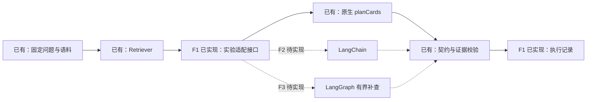

# Framework experiments

F1 of the [framework practice route (#84)](https://github.com/yuki-uix/rag-generative-ui-explorer/issues/84).
The runnable baseline addresses [#79](https://github.com/yuki-uix/rag-generative-ui-explorer/issues/79).

## Run the native baseline

From the repository root, after `pnpm install --frozen-lockfile`:

```bash
pnpm framework:smoke
pnpm framework:smoke --implementation native
```

No key, HTTP request, embedding download, or database is needed. The CLI ingests
the actual corpus, builds the existing BM25 retriever, selects three questions
from `eval/questions.jsonl`, calls `planCards` through the **real Anthropic SDK**,
resolves handles, and calls `validateCards` and `KnowledgeUIResponse.safeParse`.
Only the provider's SSE response is synthetic. Even if a key is present, smoke
mode uses a dummy key and an injected fetch implementation with no network path.

The selected questions in [config.json](config.json) cover a definition
(`rag-001`), a comparison (`rag-003`), and insufficient evidence (`ins-001`). The
fixtures quote retrieved excerpts to exercise validation; they do not establish
that the model answered a question correctly. Fixture usage is synthetic and
local timings measure plumbing, not model latency. There are no framework or
answer-quality conclusions from this run.

To explicitly make real model calls:

```bash
# Supply DEEPSEEK_API_KEY through your environment, then:
pnpm framework:live
```

The CLI prints the sample count and request budget before making calls. The
committed config allows three model requests, one per question, with SDK retries
set to **0**, a 60-second per-request timeout, and `max_tokens: 4096`. It never
repairs or repeats a failed answer. Editing the config starts a new baseline.
Unknown arguments, unknown question IDs, duplicate question IDs, a corpus/label
version mismatch, and a sample count exceeding the budget fail before model use.
Missing credentials fail without creating a run. Live mode cannot use failure
fixtures. Profile capabilities come from the existing repository profiles; F1
does not independently certify that a provider still supports that profile.

## Inspect the output

Each invocation creates a new timestamp-plus-UUID directory under
`eval/framework/runs/`, which is ignored by Git. Use `--out /absolute/directory`
to choose a parent directory. Previous runs are never overwritten.

| File | Contents |
| --- | --- |
| `run.json` | Mode, scenario, config, planned requests, code commit and working-tree fingerprint, Node/SDK/lock versions, corpus/index and question hashes, retrieval parameters, profile/endpoint/request extras, prompt version and schema hash |
| `records.jsonl` | One record per completed question: input and labels, retrieved evidence with IDs/text/scores, raw completion, attempts and usage, original/final validity, failures, validated result, stop reason, outcome, per-stage timing |
| `summary.json` | Completion time, actual requests, failed count, and per-question outcome |

`records.jsonl` is appended after every question. If execution is interrupted,
the completed records survive; an absent `summary.json` means the invocation did
not finish. A provider error has no completed attempt; its raw field is `null`
unless visible text arrived before the stream failed. Its error record contains
only the exception name and HTTP status, avoiding credential-bearing request
objects and provider error messages. API keys are never part of the config.

Usage fields a completed response did not supply are **`null`**, never invented
zeros. A reported zero remains zero. No monetary cost is calculated. Refusals,
truncation, other non-`end_turn` stops, malformed output, and invalid evidence
produce separate outcomes and no validated result; any such record makes the CLI
exit nonzero after saving the run. A legitimate incomplete answer is successful.

`validation.originalValid` and `validation.finalValid` describe the unrepaired
output in F1; `repairAttempted` is always false, matching the pinned
`repair: "disabled"`. The common constrained repair behavior remains
[#25](https://github.com/yuki-uix/rag-generative-ui-explorer/issues/25). When it is
added, preserve the original attempt, add the repaired attempt separately, and
reserve both requests in the budget. A repair must not retroactively make the
original output valid.

## Reproduce a failure

```bash
pnpm framework:smoke --scenario malformed
pnpm framework:smoke --scenario invalid-reference
pnpm framework:smoke --scenario provider-error
pnpm framework:smoke --scenario truncated
pnpm framework:smoke --scenario refusal
```

These commands intentionally exit 1 and save the diagnostics. An invalid handle
such as `E999` remains in the raw completion and yields an `evidence-reference`
failure with `result: null`. It is never replaced by a plausible corpus ID or
repaired. See [EXECUTION.md](EXECUTION.md) for an observed run and debugging case.

## Where the framework goes



[`ExperimentAdapter`](../../packages/generation/src/experiment/run.ts) has only
an ID and a `plan(PlanOptions)` method. The native adapter calls the existing
[`planCards`](../../packages/generation/src/planner/plan.ts); retrieval and
validation stay outside it. The CLI currently accepts only `native`. This is a
small seam, not a plugin registry, and introduces no framework dependency into
Evidence, card contracts, or React components. It uses main's validator; the
separate output-gate PR [#71](https://github.com/yuki-uix/rag-generative-ui-explorer/pull/71)
can replace that validation entry after merge without changing the experiment
contract. CLI results do not enter the web renderer.

Native SDK remains the default until a comparison justifies changing it. It
currently needs one generation call and ordinary TypeScript control flow;
adding a framework to F1 would change the baseline before it had been recorded.

## Next tasks and comparison plan

GitHub issues are the task source of truth. The next steps are:

| Order | Task | What to hold fixed / inspect |
| --- | --- | --- |
| F2 | [#80 LangChain](https://github.com/yuki-uix/rag-generative-ui-explorer/issues/80) | Same questions, evidence order, prompt, schema, model, endpoint, budget and validator; record actual request differences |
| F3 | [#81 LangGraph](https://github.com/yuki-uix/rag-generative-ui-explorer/issues/81) | Separate strategy experiment: at most one additional retrieval, visible branch and stopping reason; account for the additional calls |
| F5 | [#83 Findings](https://github.com/yuki-uix/rag-generative-ui-explorer/issues/83) | Follow PROTOCOL, include failures, costs, negative results and framework-specific maintenance work |
| Optional F4 | [#82 Checkpoints](https://github.com/yuki-uix/rag-generative-ui-explorer/issues/82) | Resume after restart; explain the boundary with business RunStore, not a prerequisite for F5 |

Before running the full comparison, freeze the arms and follow
[PROTOCOL.md](../PROTOCOL.md): the complete 60-question set, three repetitions,
matching pinned variables and explicit per-arm call budgets. Report validity
before/after any repair, citation failures, insufficient-evidence decisions,
model/request outcomes, latency median and range, and all four available token
counts. Unavailable values stay unavailable. F2 compares implementations on
identical retrieval; F3 intentionally changes retrieval strategy and must be
reported separately. These three-sample integration runs cannot establish
framework benefit or meet the MVP's effectiveness criteria.
