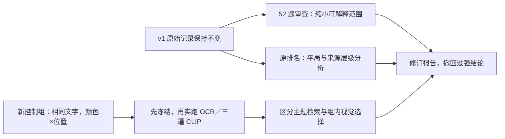

# PR #92 review and corrections

**2026-10-22. Three material method problems were found and addressed.**
The original pilot is retained as immutable historical evidence. Its aggregate
model-adoption comparison is withdrawn: incomplete semantic labels, different
information availability and confounded visual queries do not support that claim.
The current conclusion is to retain all arms as experiments, with their strengths
reported only under the controlled task actually measured.

## Findings and fixes

| Priority | Finding | Evidence | Fix |
| --- | --- | --- | --- |
| P1 | Some single-image concept gold is incomplete; rendered diagrams were not exhaustive relevance judgments | `figure-03-a-concept` asks about fusing ranks instead of raw scores; both original fusion diagrams satisfy that description | Preserve original labels, add a 52-row [gold audit](results/2026-10-22/gold-audit.json); exclude all 12 concept questions from primary effectiveness claims rather than relabelling after results |
| P1 | Original layout/color/content variables are inseparable | Every requested orange branch diagram also changes node words, arrows, text length and ID suffix | New independently frozen 2×2 color/position control per family, equal printed words, all styles queried; real OCR/CLIP run, plus a printed-text ablation |
| P2 | Full-note BM25 rows duplicate a source and rank equal images by ID; this is not an algorithm-only comparison | Original text layout hit@1 is 0%, but uniform exact-tie expectation is 50% and source-family hit is 100% | Report image hit, tie expectation and source-family hit separately; new source arm indexes each distinct note once before expanding to image IDs |
| P2 | One diagram misstates a source constraint as an execution stage | Original query-transformation chain ends at `Original intent`, while the note recommends retrieving original and transformed queries and fusing candidates | Add a [corrected illustration](corrections/query-transformation.png) with distinct provenance/ID; mark original image as an erratum, never silently replace frozen input bytes |

The findings are grounded in the [original corpus generator](../images/build-corpus.py),
[original scoring implementation](../../packages/corpus/scripts/images/evaluate.ts)
and [review validator/tie calculation](../../packages/corpus/src/image-review.ts).

This review is by the same Codex assistant, not an independent human audit.
A semantic gold label is not made reliable by hashing it. The new physical-attribute
gold is instead derived from explicit rendering attributes, and validators check
all four variants, query wording/kind and every positive ID. That is still an
authored diagnostic, not a blind external benchmark.

### Corpus and gold scope

All 24 original literal queries were checked against the quoted node label and
specified topic; each has exactly the original single matching image. They remain
**exact-label lookup tasks**, not answer-support or general relevance judgments.
Ten of the concept queries retain plausible intended targets but lack exhaustive
alternative-candidate adjudication. The fusion concept has a demonstrated second
valid figure. Query-transformation also has a content erratum. None of those 12
queries is used for the revised primary comparison. Four negatives remain
uncalibrated OOV/neighbor diagnostics, not answer-refusal accuracy.

The original source-note snapshots match their recorded Git commit and their
hashes remain unchanged. Source attribution alone does not verify every arrow.
The original branch images are simplified concept maps, not executable workflow
specifications. The corrected query-transformation diagram follows the source's
[“Keeping the original” section](../images/sources/doc-07.md#keeping-the-original):
original and rewritten retrieval both feed fused candidates. No retrieval result
was recomputed under a silently changed original diagram ID.

### Fairness and tie handling

The original text arm has full source prose; OCR/CLIP only see selected image
pixels. Same candidate IDs therefore do not imply equal available information.
The comparison is between evidence-access paths, not proof that CLIP is a worse
retrieval algorithm than BM25 or the product's dense/hybrid pipeline.

[Post-hoc diagnostics](results/2026-10-22/summary.json) reuse original sealed
rankings. No score jitter, threshold tuning, query rewrite or favorable tie break:

| Original slice | Arm | Unique n | Stored deterministic hit@1 | Uniform top-tie expectation | Source-family hit@1 |
| --- | --- | ---: | ---: | ---: | ---: |
| Exact labels | Text | 24 | 50.0% | 47.9% | 95.8% |
| Exact labels | OCR | 24 | 100% | 100% | 100% |
| Exact labels | CLIP | 24 | 41.7% | 41.7% | 54.2% |
| Confounded layout | Text | 12 | 0% | 50.0% | 100% |
| Confounded layout | OCR | 12 | 100% | 100% | 100% |
| Confounded layout | CLIP | 12 | 58.3% | 58.3% | 58.3% |

Tie expectation is relevant-count / size of the exact highest-score tie. It is
an alternative descriptive statistic, not a changed ordering, calibrated
probability of correctness, or an optimistic tie bound. Source-family hit uses
coarser labels: it measures finding a note, not distinguishing its figures.

## New frozen visual controls

[Protocol](PROTOCOL.md), [manifest](manifest.json), [questions](questions.json),
[freeze](freeze.json), [measured observation seal](observations.json).
Six already exposed source topics, four variants each:

- Blue/orange × column/diamond, 24 images. Same title, node words, font, box size
  and canvas within a family. IDs are not printed and the ID/style mapping rotates.
- No arrows: this isolates color and physical arrangement, not dependencies,
  graph topology or causal flow. This is an explicit diagnostic corpus, not a
  replacement set of authoritative process diagrams.
- 54 questions: 24 color+position, 12 color-only, 12 position-only and six topic-only.
  They have one, two, two and four positives respectively. Recall and hit therefore
  differ, and both remain available in the [648 scored rows](results/2026-10-22/records.jsonl).
- Three core arms: source-text BM25, actual OCR BM25, actual q8 CLIP. Source text
  is indexed once per family, not four copied documents. An extra
  `visible-text-control` ablation indexes the exactly printed words; it is an
  oracle textual control, not OCR or a fourth competing model.

The control was designed **after seeing v1 results**. Its own inputs/code were
frozen before these new observations; that does not make it a fresh holdout.
No development/evaluation or independent-person claim is made. The six topics
and shared templates limit generalization. Three repeated passes do not increase
the number of independent sources beyond six.



## Measured results

All three encoding passes produce identical ranking orders and metrics. The
following are per-pass medians; metric min/max equal the median. Counts are unique
queries, not queries multiplied by three. Raw projected FP32 tensors, row IDs,
hashes, timings, model/runtime identities and original OCR are committed.

First, condition on knowing the correct source family and select among its four
images. This **conditional choice test** is distinct from full-corpus retrieval:

| Question kind | Unique n | Source text hit@1 | OCR hit@1 | Printed-text control | CLIP hit@1 | Balanced text/chance reference |
| --- | ---: | ---: | ---: | ---: | ---: | ---: |
| Color + position | 24 | 25.0% | 25.0% | 25.0% | 54.2% | 25.0% |
| Color only | 12 | 50.0% | 50.0% | 50.0% | 91.7% | 50.0% |
| Position only | 12 | 50.0% | 50.0% | 50.0% | 58.3% | 50.0% |
| Topic only | 6 | 100% | 100% | 100% | 100% | All four are relevant |

CLIP's source-family-restricted conjunction hit is 13/24 versus 6/24 for its
matched topic-only query-vector ablation. This supports sensitivity to the added
visual request on this control. Color-only success is 11/12. Position-only is
7/12 versus a 6/12 balanced reference: one additional success with correlated
questions across six templates is not robust evidence of position understanding.
Color can explain much of the conjunction benefit; do not call it graph reasoning.

Full 24-image corpus results tell a different part of the story:

| Question kind | Source text hit@1 | OCR hit@1 | CLIP hit@1 | CLIP correct-family hit@1 |
| --- | ---: | ---: | ---: | ---: |
| Color + position | 25.0% | 25.0% | 45.8% | 75.0% |
| Color only | 50.0% | 50.0% | 91.7% | 100% |
| Position only | 50.0% | 50.0% | 25.0% | 41.7% |
| Topic only | 100% | 100% | 100% | 100% |

Even where CLIP makes some useful within-family visual distinctions, added
position language can overwhelm topic matching. For `doc-02-diamond`, the right
within-family style is first, but the full-corpus winner is an incremental-rendering
image (`control-05-4`). `doc-10-column` fails even within its correct family.
`doc-02-blue` is the remaining color-only failure. These losses are preserved.
Top-five recall is not a substitute for selecting a style: for the text paths it
can reach 100% simply because all four tied variants fit inside K=5.

Actual OCR token bags are identical within five families; the reranking family
has two observed bags due to recognition variation. No OCR correction is applied.
The printed-text ablation guarantees all four ideal text bags are identical.
Both OCR and that control end at the balanced reference for color/position. This
removes the original word-content/arrow-template shortcut rather than claiming
that OCR's old 100% layout score demonstrated visual interpretation.

## Timing, reproduction and remaining boundary

Measured on the same Apple M4 Pro machine and model/runtime as v1. CLIP is
forced to CPU; Apple Vision uses its default system execution device. Verified
local weights were reused, with no downloads or hosted inference in the control run:

| Stage | Actual observation |
| --- | --- |
| OCR, 24 images | 1,216.55 ms total |
| Cached CLIP loading | 194.50 ms |
| Three complete encoding passes | 3,209.59 ms measured stage, including file verification, cache loading and FP32 pass export; excludes Node startup/final metadata serialization |
| Image read/preprocess/encode | n=72; median 30.77 ms [28.64, 42.18] |
| Query tokenize/encode | n=162; median 4.15 ms [2.16, 5.68] |
| Peak encoding process RSS | 831,440 KiB (about 812.0 MiB), not model-only allocation |

Offline scoring times remain in each row; they are separate from historical
encoder timings, not invented end-to-end latency. Index construction was not
separately timed in this follow-up and is not substituted with the old run's setup timings. No inference-provider calls
or charges; local hardware/electricity/engineering remain unpriced. Raw binary
storage preserves original projected FP32 outputs exactly and is not synthetic
fixture data. The separate control corpus has an enforced 3 MiB budget; v1 keeps
its original 5 MiB budget and original freeze.

```sh
pnpm images:budget
pnpm images:replay --out /absolute/path/to/fresh/v1-replay
pnpm images:review --out /absolute/path/to/fresh/review-replay
```

Both replays need no model download, Apple Vision or API key. CI verifies frozen
bytes/code, observation seals, complete factorial gold, equal printed text,
raw-vector shapes/hashes/finite norms, exact ranking IDs/metrics and cross-platform
score tolerance. Raw v1 records, labels and scoring code are not rewritten.
The new diagnostic has its own freeze; F5's corpus, questions, generation code,
protocol, configs, observations and branch remain untouched. No LLaVA is added.

The latest CI at the start of this review was already green on `79df2fb`; the
historical red run on `cc82762` was the one-ULP score assertion corrected there.
The additional review checks run on the new PR head; old CI success is not used
as evidence for untested new changes.
