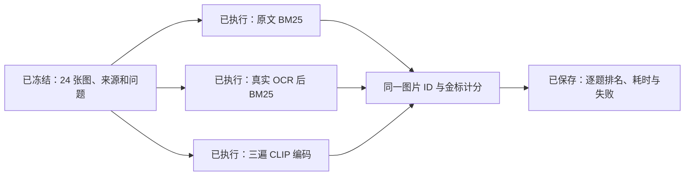

# I1–I3: measured image-retrieval pilot

**2026-10-21. Keep CLIP as an experiment; retain paired text and OCR as baselines.**
On this small authored technical-diagram set, OCR provided the strongest first
result, paired source text provided the strongest top-five recall, and q8 CLIP
provided neither overall advantage. This does not compare every text retriever
or every CLIP implementation, and does not establish general diagram understanding.

## Data and execution identity

24 repository-authored PNG diagrams, two per source note; 12 exact source-note
snapshots from `37813a2`; 52 English queries (48 answerable and four negatives).
Six source groups belong to development and six to evaluation, with 24 answerable
queries and two negatives per split. All 24 images are candidates for every arm.
The same assistant authored corpus, questions, labels and code: this is an exposed
source-grouped diagnostic, not an independent or blind benchmark. Label relevance
was authored and visually checked by that assistant; no independent human review.

The [protocol](PROTOCOL.md), [manifest](manifest.json), [questions](questions.json)
and code were frozen before the complete observations. [Preflight history](PREFLIGHT.md)
retains setup failures and the earlier freeze; its input-file map is identical
to the final map. No question, label, image, protocol or retrieval parameter was
changed after inspecting rankings. [Observation hashes](observations.json) seal
original OCR, encoding and comparison outputs after the run. New replay/audit
wrappers do not rewrite the frozen execution algorithms or original results.

- Text: actual repository BM25, `k1=1.2`, `b=0.75`, on paired source-note bodies.
  One row per image; the two images sharing a note have identical indexed text.
  This is not the product's dense/fused retrieval pipeline or chunk-level baseline.
- OCR: real Apple Vision revision 3, accurate English recognition with correction
  disabled. It reads PNG pixels; all recognized strings, boxes and confidence
  values are preserved. Render specs and question labels never enter its index.
- CLIP: `Xenova/clip-vit-base-patch32`, revision
  `d15189d7028b43f1d3e65039190477f6af591c2a`, q8 text/vision ONNX projections,
  CPU, Transformers.js 3.8.1 and ONNX Runtime 1.21.0. Raw questions, no prompt
  template or truncation, 512-dimensional L2-normalized vectors and cosine scores.
  The model conversion and quantization are part of the baseline. Effective
  processing uses shortest-edge resize to 224 and a 224×224 center crop, RGB and
  the saved normalization constants. These square images lose no aspect-ratio
  margins, but their small labels are heavily downsampled.

CLIP ran **three complete encoding passes**, each recomputing all 24 image and
52 question vectors, within one process with loaded weights. All three ranking
orders and metric values were identical. The score dataset contains **468 rows**
(52 questions × 3 arms × 3 passes). Repetition does not turn 24 evaluation
questions into 72 independent examples. Ranking metrics are mechanical for the
saved vectors; timing variation remains observational.



## Retrieval results

Values below are repetition medians; each metric's min/max equals its median.
The [original summary](results/2026-10-21/summary.json) retains repetitions,
category/split slices and full timing distributions; [raw rows](results/2026-10-21/records.jsonl)
retain every candidate score. Each positive question has one golden image,
so Recall@K and hit@K coincide in this corpus; the implementation also supports
multiple golden images without confusing hit with recall.

| Split | Arm | Unique answerable n | Recall@1 | Recall@3 | Recall@5 | MRR@5 | nDCG@5 |
| --- | --- | ---: | ---: | ---: | ---: | ---: | ---: |
| Development | Text | 24 | 45.8% | 95.8% | 95.8% | 0.708 | 0.774 |
| Development | OCR | 24 | 83.3% | 91.7% | 95.8% | 0.885 | 0.904 |
| Development | CLIP | 24 | 37.5% | 41.7% | 50.0% | 0.408 | 0.430 |
| Evaluation | Text | 24 | 37.5% | 95.8% | 95.8% | 0.646 | 0.727 |
| Evaluation | OCR | 24 | **87.5%** | 91.7% | 91.7% | **0.896** | **0.901** |
| Evaluation | CLIP | 24 | 33.3% | 54.2% | 70.8% | 0.459 | 0.520 |
| All exposed questions | Text | 48 | 41.7% | 95.8% | **95.8%** | 0.677 | 0.750 |
| All exposed questions | OCR | 48 | **85.4%** | 91.7% | 93.8% | **0.891** | **0.903** |
| All exposed questions | CLIP | 48 | 35.4% | 47.9% | 60.4% | 0.433 | 0.475 |

Category boundaries matter:

| Evaluation category | n | Text R@1 / R@5 | OCR R@1 / R@5 | CLIP R@1 / R@5 |
| --- | ---: | --- | --- | --- |
| Literal labels | 12 | 50.0% / 91.7% | 100% / 100% | 33.3% / 91.7% |
| Conceptual flow | 6 | 50.0% / 100% | 50.0% / 66.7% | 0% / 16.7% |
| Layout | 6 | 0% / 100% | 100% / 100% | 66.7% / 83.3% |

**The layout score is not proof of spatial reasoning.** OCR's BM25 does not
consume boxes, colors or arrows. Those queries also name the diagram topic;
topic terms, differences in recognized text/document length and the fixed
rendering template can select the right variant without reading its layout.
For example, the reranking pair receives OCR BM25 scores 2.527 (branched) and
2.262 (vertical) for the layout query. Vertical arrows are sometimes recognized
as the letter `Y`, and remain in the index. The exact causal contribution of
length/noise has not been isolated by ablation. A future layout test should use
matched text with counterbalanced layouts and independent labels. These labels
and images were not redesigned after this finding.

Likewise, source text cannot distinguish two figures with identical paired text;
its ID-based ties systematically favor `-a`. That explains part of top-one
behavior and is an explicit limitation of this adapter, not evidence that the
existing production retrieval system is 37.5% accurate. Source-note splits still
share authored templates and query phrasing; they are not unseen external data.

## Inspectable cases

[Case details](cases.json) were selected after examining the results; full rows
remain available for every question and pass. Ranks below are from pass 1 and
are unchanged in passes 2 and 3.

| Case | Golden image | Text rank | OCR rank | CLIP rank | Observation |
| --- | --- | ---: | ---: | ---: | --- |
| `figure-04-b-layout` | [Reranking branches](assets/figure-04-b.png) | 2 | 1 | 1 | CLIP finds the requested image and improves the text tie, but adds no gain over OCR |
| `figure-08-a-literal` | [Grounded-generation chain](assets/figure-08-a.png) | 1 | 1 | 1 | All succeed; additional image encoding has no ranking benefit |
| `figure-02-a-concept` | [Dense retrieval](assets/figure-02-a.png) | 3 | absent | 16 | Paired prose retrieves the concept; OCR has no matching terms in the target; CLIP's top result is a reranking diagram |
| `figure-10-b-layout` | [Incremental rendering](assets/figure-10-b.png) | 2 | 1 | 12 | CLIP retrieves other branch diagrams but misses the correct topic in top five |

Across all 48 answerable questions, CLIP has **zero additional hit@1/3/5 successes
over OCR**. OCR has 24/21/16 successes respectively where CLIP misses. This is a
negative result for adding this CLIP arm on this dataset; individual CLIP success
examples should not be presented as unique benefits.

All four negative queries receive neighbors from text and CLIP; OCR returns no
candidate for all four. That is a lexical OOV result, not a calibrated
insufficient-evidence detector. For example, the Kubernetes-autoscaler negative
gets CLIP cosine 0.281 for a query-transformation diagram, close to the 0.283
score of a genuine grounded-generation match in a different query. Cross-query
similarity is not confidence; no rejection threshold or answer-accuracy claim
is inferred from these examples.

## Actual timing and resource observations

Machine: Apple M4 Pro, macOS 26.6.2 build 25G83, arm64, Node v23.7.0. Encoder
sessions use one intra-op and one inter-op CPU thread. Results are local timings,
not browser TTFC, hosted-service latency or production capacity measurements.

| Stage | Measurement |
| --- | --- |
| Real OCR, 24 images | 1,223.17 ms total; per-image median 43.20 ms [40.65, 194.99] |
| Successful verified weight acquisition | 57,017.06 ms using 16 byte-range connections; excludes the abandoned initial sequential wait |
| CLIP model loading from complete cache | 234.04 ms |
| Three-pass encoding process work | 3,138.83 ms including cache load and model-file hashing; excludes Node startup and prior download |
| Image read + preprocessing + encoding | n=72; median 29.22 ms [28.25, 41.82] |
| Question tokenization + encoding | n=156; median 4.30 ms [3.00, 10.00] |
| Text / OCR index construction | 5.104 / 0.142 ms |
| Text in-memory search | n=156; median 0.0096 ms [0.0057, 5.5162] |
| OCR in-memory search | n=156; median 0.0033 ms [0.0016, 0.0128] |
| CLIP cosine search, precomputed vectors | n=156; median 0.0805 ms [0.0667, 0.8839] |
| Peak CLIP process RSS | 897,824 KiB (about 876.8 MiB); process-wide peak, not model-only allocation |
| Cached model + tokenizer/processor bytes | 155,851,446 bytes (about 148.6 MiB); two ONNX weights alone total 153,621,508 bytes |

Search is freshly measured in the scoring process; encoder observations are
from the separate real encoding process at 22:17:48–22:17:51 Asia/Shanghai.
The table separates those phases rather than inventing an end-to-end request
measurement. First search includes warm-up/outlier effects; no observed maximum
was discarded. OCR time excludes Swift compilation. Weight-acquisition and
[setup failures](PREFLIGHT.md) are explicit: 57 seconds is not the complete
first-use wall time, since the earlier slow attempt was not fully instrumented.
[Acquisition identity/timing](artifacts/weights-download.json) and [all model
file hashes/runtime/preprocessing](artifacts/encoding.json) remain inspectable.

There were **zero hosted inference API calls and zero hosted-provider inference
charges**. Local hardware, electricity, model download and engineering time have
not been monetized; this is not a zero-total-cost claim. Model weights remain
ignored. The committed experiment is below its enforced 5 MiB budget.

## Reproduction, decision and remaining limits

From a clean checkout, install dependencies and run:

```sh
pnpm images:budget
pnpm images:replay --out /absolute/path/to/fresh/output
```

Replay verifies frozen source/image/query/code hashes, observation-file hashes,
the exact published q8 weight identities, complete OCR/embedding coverage and
unit-vector dimensions, then recomputes all rankings and metrics. It downloads
nothing and needs neither macOS OCR nor credentials. Replayed search timings are
new observations; original timing files stay immutable. Linux CI exposed one-ULP differences in
BM25 scores (for example 0.7846298054163152 versus 0.7846298054163151). Replay
tests require exact image-ID order and exact metrics, with a `1e-12` relative
score tolerance and absolute floor of `1e-12`. No scoring algorithm or original
observation was changed to accommodate this runtime difference. See the [README](README.md)
for explicit commands that create fresh local OCR/encoding observations.

Retain both paired text and OCR for further experiments. OCR was better at exact
labels and first result selection; paired prose still recovered conceptual
questions OCR could not match. CLIP stays experimental: no measured top-K gain
over OCR offsets its additional encoder, weights and memory here. No production
retriever, schema, card gate or image UI is changed, and LLaVA is not connected.
The original knowledge, 60-question set, evaluation protocol and F5 paths remain
unchanged. Independent heterogeneous figures, a stronger text baseline, reviewed
relevance alternatives and counterbalanced visual tests would be a new baseline,
not a retrospective improvement to this report.
