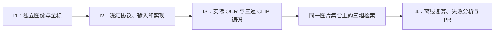

# Independent image-retrieval experiment

Scope approved 2026-10-21: authored image corpus, frozen evaluation protocol,
real text/OCR/CLIP retrieval comparison and a reviewable PR. LLaVA and product
image evidence/rendering are deferred. This work does not change F5 #83,
`knowledge/`, `eval/questions.jsonl`, `eval/PROTOCOL.md` or `eval/framework/`.

## Existing requirements this work follows

- [#10](https://github.com/yuki-uix/rag-generative-ui-explorer/issues/10): freeze variables before evaluation; keep a separate protocol for this baseline.
- [#12](https://github.com/yuki-uix/rag-generative-ui-explorer/issues/12) / [#13](https://github.com/yuki-uix/rag-generative-ui-explorer/issues/13): reuse the retriever/BM25 implementation and report each arm independently.
- [#17](https://github.com/yuki-uix/rag-generative-ui-explorer/issues/17) / [#33](https://github.com/yuki-uix/rag-generative-ui-explorer/issues/33): retain original observations, actual timing and cost boundaries.
- [#38](https://github.com/yuki-uix/rag-generative-ui-explorer/issues/38): repository-authored illustrations must not be attributed to cited papers.
- [#63](https://github.com/yuki-uix/rag-generative-ui-explorer/issues/63): put measured artifacts under a justified size budget; leave weights out of Git.
- [#84](https://github.com/yuki-uix/rag-generative-ui-explorer/issues/84): leave runnable commands, complete traces, failure analysis and an adoption decision.

## Task breakdown and acceptance

| Task | Depends on | Reviewable acceptance evidence |
| --- | --- | --- |
| [I1 / #89](https://github.com/yuki-uix/rag-generative-ui-explorer/issues/89) Independent images and labels | none | 24 original PNG diagrams; exact snapshots of 12 source notes with commit/hash/license; 52 English queries; source-group split; unique IDs and exhaustive source/image checks |
| [I2 / #90](https://github.com/yuki-uix/rag-generative-ui-explorer/issues/90) Freeze protocol and execution | I1 | separate `PROTOCOL.md`, model revision/quantization/processor policy, fixed K and ties, negative-query boundary, immutable input/code hashes before complete observations |
| [I3 / #91](https://github.com/yuki-uix/rag-generative-ui-explorer/issues/91) Real OCR and CLIP comparison | I2 | actual Apple Vision output with boxes/confidence, three actual CLIP encoding passes, same candidate IDs, per-query rankings/metrics/timing; no fixture substitution or API keys |
| I4 Findings, reproduction and PR | I3 | offline replay/CI, per-split and per-category results, successes/failures/regressions, latency and memory/model bytes, no hosted charge with local costs unpriced; F5 path diff empty |

All claims concern this small, exposed, same-author diagnostic corpus. Completing
these tasks does not complete F5, prove a production retrieval gain, or provide
image-grounded card generation.
